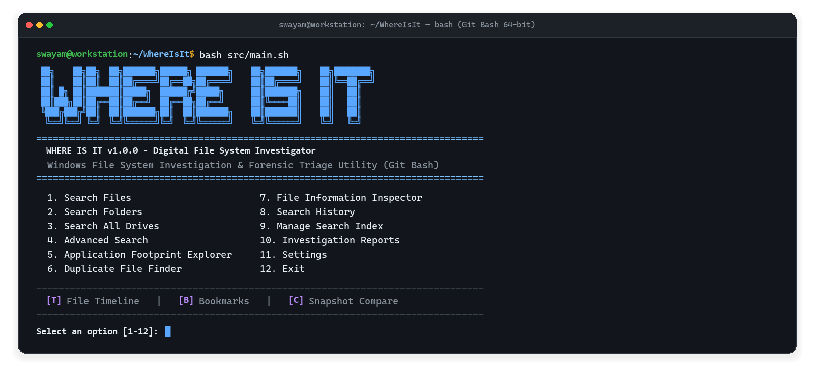

# WHERE IS IT: Digital File System Investigator

<div align="center">



[](https://www.gnu.org/software/bash/)
[](https://gitforwindows.org/)
[](LICENSE)
[](#11-safety--reliability-guarantees)

</div>

---

## 1. Project Overview

**Where Is It** is a standalone, terminal-driven Digital File System Investigator and triage tool built primarily with **Bash Shell Scripting**. Designed for modern Windows operating systems operating within a Git Bash runtime, it provides cybersecurity students, digital forensics learners, and systems administrators with a lightweight, dependable utility to discover, index, inspect, and organize files, directories, and application artifacts across multiple storage drives.

---

## 2. Problem Statement

Windows storage devices often become fragmented and chaotic over time. Application installations scatter components across `Program Files`, `Program Files (x86)`, `AppData\Local`, `AppData\Roaming`, and secondary backup drives. Standard Windows GUI searches can be slow, resource-heavy, and uninformative regarding cryptographic verification, permission bits, and disk-level artifact associations. 

Moreover, discovering a filename matching `"Chrome"` or `"Report"` in a casual directory does not prove it belongs to a legitimate application or whether duplicate redundant copies are wasting gigabytes of disk storage. Digital investigators require a fast, read-only, command-line investigative tool that surfaces matching items with complete path transparency, cryptographic verification, and structured forensic reporting.

---

## 3. Project Objectives

- **100% Shell-First Architecture:** Implement all core logic in POSIX/GNU Bash using standard command-line utilities (`find`, `grep`, `awk`, `sed`, `sort`, `stat`, `sha256sum`, `cut`, `wc`).
- **Safe by Default:** Strictly read-only operations. Never modify, move, execute, or delete files.
- **Cross-Drive Windows Awareness:** Automatically discover and handle mounted Windows drives (`/c`, `/d`, `/e`, etc.) and seamlessly convert between POSIX paths and standard Windows backslash paths.
- **Multi-Phase Duplicate Detection:** Group files by exact byte size first, hashing only collision candidates with SHA-256 to minimize I/O overhead.
- **Application Footprint Exploration:** Detect distributed application traces across standard Windows installation and profile zones, distinguishing confirmed name matches from inferred directory associations.
- **Forensic Report Generation:** Export findings into auditable plain text reports and RFC 4180-compliant CSV files.

---

## 4. Key Features

### Core Capabilities

1. **Multi-Drive Search:** Automatically detects mounted drives (`C:`, `D:`, `E:`, etc.) or accepts custom directory roots (e.g. `./test-drive`). Supports querying individual drives, user-defined drive sets, or all accessible drives simultaneously.
2. **File Search:** Recursive filename search with case-insensitive, exact, or wildcard matching. Uncovers hidden files (`.*`), tracks extension types, and displays live match counters.
3. **Folder Search:** Recursive directory explorer displaying directory depths, modification timestamps, immediate child item counts, and full drive paths.
4. **Advanced Search Filters:** Combine multiple criteria including extension lists (e.g., `pdf,docx,xlsx`), minimum and maximum file sizes (`+10M`, `-1G`), modification time windows (`-mtime -7`), item types, and specific storage roots.
5. **File Metadata Inspector:** Deep-dive examination into any selected file or folder:
   - File name, POSIX path, and Windows backslash path
   - Exact size in bytes and human-readable units (B, KB, MB, GB)
   - Last modified time, access time, and creation time
   - File type classification and MIME format via GNU `file`
   - Read, Write, and Execute capabilities for the current user
   - Text metrics (line, word, and character counts via `wc`)
   - Cryptographic SHA-256 hash calculation
6. **Cryptographic Duplicate File Detector:** Two-phase detection algorithm:
   - Phase 1: Filters out empty files and groups non-empty files by byte size.
   - Phase 2: Computes SHA-256 hashes exclusively for files with matching sizes.
   - Summarizes duplicate clusters, total redundant files, and potential reclaimable disk space.
7. **Application Footprint Explorer:** Investigates common Windows paths (`Program Files`, `Program Files (x86)`, `ProgramData`, `AppData\Local`, `AppData\Roaming`, `Downloads`) with presets for Chrome, Firefox, Edge, VS Code, Discord, Steam, Spotify, Git, or custom keywords. Findings are categorized into `[INSTALLATION]`, `[USER DATA]`, `[CACHE & LOGS]`, `[CONFIG & SETTINGS]`, and `[INSTALLER & BACKUP]`.
8. **Search & Investigation History:** Maintains an auditable TSV log of previous investigation queries, target drives, match counts, and timestamps. Allows re-executing any past search with a single keystroke.
9. **Fast Search Indexing:** Creates a persistent local filesystem database (`index/fs_index.db`). Subsequent searches run instantaneously without recursive disk traversal. Tracks index age and provides staleness notifications.
10. **Investigation Reports:** Exports structured investigation findings into formatted `.txt` audit reports or RFC 4180-compliant `.csv` spreadsheets with full quotation escaping. Includes an audit log of inaccessible / permission-denied locations.

### Forensic Enhancements

- **A. Chronological File Timeline:** Displays files ordered by modification timestamps to trace recent user activity or system events (last 24 hours, last 7 days, last 30 days).
- **B. Suspicious File Indicators:** Rule-based anomaly heuristics:
  - Deceptive double extensions (e.g. `invoice.pdf.exe`)
  - Executable binaries located in temporary directories (`/AppData/Local/Temp`)
  - Extension vs. Magic Header mismatches (e.g. `.jpg` with `MZ` executable header)
  - Filenames containing deceptive trailing periods or whitespace
- **C. Intelligent Search Ranking:** Ranks discovered items by relevance: Exact Filename > Exact Folder > Partial Filename > Partial Folder.
- **D. Investigation Bookmarks:** Tag critical discovered paths with notes for follow-up review. Automatically verifies whether bookmarked files still exist on disk.
- **E. Snapshot State Comparison:** Captures baseline filesystem snapshots and compares them against subsequent states to pinpoint newly discovered, missing/deleted, modified, or relocated files.

---

## 5. Technologies Used

- **Scripting Language:** Bash 4.0+ (GNU Bourne-Again Shell)
- **Execution Platform:** Windows with Git Bash (MSYS2 / MinGW-w64)
- **Standard Command-Line Utilities:**
  - `find` (safe traversal, `-print0`, `-printf`, `-prune`, symlink prevention)
  - `stat` (file attributes, timestamps, octal/symbolic permissions)
  - `sha256sum` (cryptographic hash generation)
  - `awk` (data transformation, grouping, duplicate clustering, CSV formatting)
  - `sed` (path cleaning, string normalization)
  - `grep` & `sort` (fast filtering, multi-column sorting)
  - `cut` & `wc` (column extraction, text metrics)
  - `file` (binary magic signature inspection)
- **Windows Integration:** Windows Command Script (`run.bat`) for double-click launching.

---

## 6. System Architecture

```text
WhereIsIt/
|-- src/
|   |-- main.sh            # Application entry point, interactive menu, CLI flags
|   |-- utils.sh           # ANSI formatting, path conversion, human formatters
|   |-- settings.sh        # Preference storage, configuration menu, default drives
|   |-- scanner.sh         # Drive discovery, safe find traversal, error logging
|   |-- search.sh          # Search engine, result ranking, interactive results table
|   |-- filters.sh         # Multi-attribute advanced search builder
|   |-- inspector.sh       # File metadata inspector, suspicious file heuristics
|   |-- duplicates.sh      # Two-phase duplicate detector & waste calculator
|   |-- application.sh     # Application footprint explorer & category classifier
|   |-- indexer.sh         # Local filesystem index creation, search & metrics
|   |-- history.sh         # Search history persistence & re-execution
|   |-- bookmarks.sh       # Investigation bookmark manager with notes
|   |-- timeline.sh        # Chronological timeline & recent activity tracker
|   |-- comparison.sh      # Filesystem snapshot capture & differential comparison
|   \-- reporter.sh        # RFC 4180 CSV & TXT report exporter
|
|-- data/                  # Runtime session data (git-ignored)
|   \-- .gitkeep
|
|-- reports/               # Generated TXT & CSV investigation reports (git-ignored)
|   \-- .gitkeep
|
|-- tests/
|   \-- test_search.sh     # Comprehensive automated test suite
|
|-- run.bat                # Windows batch launcher (auto-locates Git Bash)
|-- README.md              # Project documentation
|-- LICENSE                # MIT License
\-- .gitignore             # Git repository rules
```

---

## 7. Installation Instructions

### Prerequisites

1. **Operating System:** Windows 10, Windows 11, or Windows Server.
2. **Git for Windows:** Download and install [Git for Windows](https://git-scm.com/download/win), which provides Git Bash and standard GNU core utilities.

### Setup

Clone the repository or download the source code:

```bash
git clone https://github.com/swayamprabhu2005/WhereIsIt.git
cd WhereIsIt
```

No external compilers, package managers, or language runtime installations (Python, Node, Java) are required.

---

## 8. Execution Instructions

### Method 1: Windows Batch Launcher (Recommended for Windows)

Double-click `run.bat` or run from Windows Command Prompt / PowerShell:

```cmd
run.bat
```

`run.bat` automatically locates `bash.exe` in your `PATH`, standard installation directories (`C:\Program Files\Git\bin\bash.exe`, `%LOCALAPPDATA%\Programs\Git`), or custom Git installations.

### Method 2: Direct Execution in Git Bash

Launch Git Bash, navigate to the project directory, and execute:

```bash
bash src/main.sh
```

### Method 3: Command-Line Automation (CLI Flags)

`WhereIsIt` can also be executed in automated, non-interactive mode via command-line arguments:

```bash
# Search for files matching 'report' in drive C:
bash src/main.sh --search report --type file --root /c

# Detect duplicates inside a specific folder
bash src/main.sh --duplicates "/c/Users/Username/Documents"

# Explore the footprint of an application
bash src/main.sh --app "Chrome"

# Inspect metadata of a specific file
bash src/main.sh --inspect "C:\Windows\System32\notepad.exe"

# Display CLI assistance
bash src/main.sh --help
```

---

## 9. Usage Examples

### 1. Interactive Menu Navigation

```text
========================================================================
                              WHERE IS IT
                       DIGITAL FILE INVESTIGATOR
========================================================================

  1. Search Files
  2. Search Folders
  3. Search All Drives
  4. Advanced Search
  5. Application Footprint Explorer
  6. Duplicate File Finder
  7. File Information Inspector
  8. Search History
  9. Manage Search Index
  10. Investigation Reports
  11. Settings
  12. Exit
------------------------------------------------------------------------
  [T] File Timeline | [B] Bookmarks | [C] Snapshot Compare
------------------------------------------------------------------------
Select an option: 
```

### 2. Multi-Drive Search Results with Ranking

```text
========================================================================
                 INVESTIGATION RESULTS: 'report'
========================================================================
Summary: 3 matching items found (3 files, 0 folders) in 1 second(s).
------------------------------------------------------------------------
No.   Type   Rank   Size       Modified Date        Discovered Path
------------------------------------------------------------------------
1     [FILE] EX-FILE 1.45 MB   2026-11-05 14:22:10  C:\Documents\report.pdf
2     [FILE] P-Match 1.45 MB   2026-11-06 09:15:00  D:\Backups\report-copy.pdf
3     [FILE] P-Match 24.5 KB   2026-11-07 10:00:00  D:\Work\Annual Summary Report 2026.docx
------------------------------------------------------------------------
Available Actions:
  [1-500] Inspect Metadata of item number
  [E]     Export Investigation Report (TXT or CSV)
  [T]     View Timeline of Discovered Items
  [B]     Bookmark an Item
  [S]     Check for Suspicious Indicators
  [M]     Return to Main Menu
```

### 3. Deep Metadata Inspection

```text
========================================================================
                    FILE SYSTEM METADATA INSPECTOR
========================================================================
  Target Name:           invoice.pdf.exe
  Windows Path:          C:\Users\User\AppData\Local\Temp\invoice.pdf.exe
  POSIX Path:            /c/Users/User/AppData/Local/Temp/invoice.pdf.exe
  Item Category:         regular file
  Identified Format:     PE32+ executable (GUI) x86-64, for MS Windows
  File Extension:        exe
  File Size:             482.50 KB (494080 bytes)
------------------------------------------------------------------------
  Last Modified:         2026-11-07 10:14:02
  Last Accessed:         2026-11-07 11:30:00
  Creation Time:         2026-11-07 10:14:00
  Hidden Status:         No
  POSIX Permissions:     -rwxr-xr-x (755)
  Effective Access:      Read: Yes | Write: Yes | Execute: Yes
------------------------------------------------------------------------
  SHA-256 Checksum:      e3b0c44298fc1c149afbf4c8996fb92427ae41e4649b934ca495991b7852b855
------------------------------------------------------------------------
[!] SUSPICIOUS FILE INDICATORS AUDIT:
  * CRITICAL: Deceptive double extension detected (.pdf.exe).
  * WARNING: Executable binary residing in temporary directory.
```

### 4. Duplicate File Detection

```text
========================================================================
                    DUPLICATE INVESTIGATION SUMMARY
========================================================================
Investigation Metrics:
  * Scanned Files:               1,248
  * Duplicate Clusters:          1
  * Total Redundant Files:       3
  * Potential Reclaimable Space: 28.40 MB (29779968 bytes)
  * Investigation Time:          2 second(s)
------------------------------------------------------------------------
DUPLICATE GROUP 1
File Size: 14.20 MB (14889984 bytes) | Copies: 3 | Redundant Waste: 28.40 MB
SHA-256: 7f83b1657ff1fc53b92dc18148a1d65dfc2d4b1fa3d677284addd200126d9069
Matching Files:
  * C:\Users\User\Downloads\setup_installer.iso
  * D:\Software Backup\setup_installer.iso
  * E:\Archived Images\installer_copy.iso
```

---

## 10. Automated Testing

The project includes an automated test suite (`tests/test_search.sh`) that establishes an isolated, mock multi-drive filesystem (`test-drive/Drive_C`, `test-drive/Drive_D`) containing:
- Exact and partial filename targets
- Directory structures matching keywords
- Case-variant filenames (`CHROMEINSTALLER` vs `ChromeInstaller.exe`)
- File paths containing multiple consecutive spaces
- Cryptographic duplicate files across disparate directories
- Anomaly samples (double extensions, fake headers, empty files, hidden files)

Run the test suite:

```bash
bash tests/test_search.sh
```

---

## 11. Safety & Reliability Guarantees

- **Non-Destructive:** No deletion, renaming, moving, or editing commands (`rm`, `mv`, `sed -i`, `truncate`) are executed against target files.
- **Symlink Protection:** Directory scans invoke GNU `find -P` by default to prevent infinite recursion across Windows junction loops (e.g. `Application Data -> AppData\Roaming`).
- **Path Sanitization:** All file reads, variable expansions, and arguments are strictly quoted to prevent command injection and accommodate filenames containing spaces, commas, ampersands, or Unicode characters.
- **Graceful Error Handling:** Permission-denied errors and system-protected folders (`System Volume Information`, `$RECYCLE.BIN`) are caught, recorded in an error audit log, and summarized without crashing the investigation.
- **Signal Interruption:** Traps `SIGINT` (Ctrl+C) and `SIGTERM` to safely flush terminal states and remove temporary cache files.

---

## 12. Limitations

- **Forensic Triage Tool, Not AV/EDR:** The suspicious file heuristics detect filename tricks, location anomalies, and magic header mismatches. They are intended for investigative triage and do not constitute an antivirus or dynamic malware analysis engine.
- **Index Latency:** The local filesystem index represents a point-in-time snapshot. Files created or deleted after building the index will not be reflected until refreshed.
- **Filesystem Permissions:** The investigator operates under the permissions of the user running Git Bash. System-locked files or directories owned exclusively by `NT AUTHORITY\SYSTEM` may report permission denied unless executed in an elevated terminal.

---

## 13. Future Enhancements

- **Deep File Content Search:** Full-text regex searching across uncompressed files (`pdfgrep`, `ripgrep`).
- **SQLite Index Backend:** Optional embedded SQLite cataloging for indexing multi-terabyte drives with billions of files.
- **YARA Rule Integration:** Optional pattern matching against user-provided YARA signatures for threat hunting.
- **Graphical Web Dashboard:** Lightweight local web dashboard rendering investigation graphs.

---

## 14. License

This project is licensed under the **MIT License**. See the [LICENSE](LICENSE) file for complete details.
